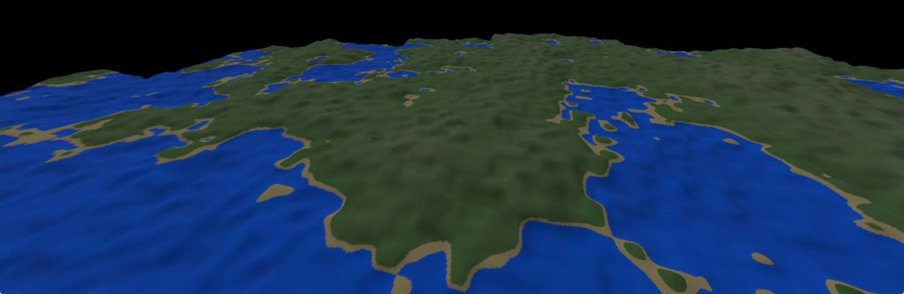

# Digital Dominion

An infinite 3D world that generates in the browser as you fly around it. I started it in January 2025 as the base for a god game, where you guide mortals and LLM-driven characters react to what you do. Only the terrain exists so far.

It's JavaScript with Three.js and Vite. The terrain, noise and chunk loading are my own code, with no terrain libraries or pre-made assets.



*Seed 3.*

## What's there

- The same seed always gives the same world, and it's generated as you move.
- Chunks near the camera are drawn at high resolution and far ones at lower resolution, with a cap on how many of each are kept (`ChunkManager`).
- The large-scale shape comes from Worley noise over a grid of tectonic plates (`PlateManager`, `PlateChunk`), layered with height maps. This part is still in progress.
- Climate and rock-layer generators, which only affect the colouring so far.
- A Mersenne Twister random number generator and spiral indexing, so each cell gets the same random values every time.
- A free-flight camera with a speed boost and a top-down view.

## Getting started

Requires [Node.js](https://nodejs.org/) 18+.

```bash
git clone https://github.com/jwseymour/digitalDominion.git
cd digitalDominion
npm install
npm run dev
```

Vite opens the app in your browser. Use **New Simulation** for a random seed, or type a seed in the box.

| Key | Action |
| --- | --- |
| `W A S D` / arrows | Move |
| `Space` / `Shift` | Up / down |
| `B` | Speed boost |
| `T` | Toggle top-down view |
| Click, then move mouse | Look around (pointer lock) |

Other scripts: `npm run build` (production bundle in `dist/`) and `npm run preview`.

## Project structure

```
src/
├── index.html
├── js/
│   ├── main.js                    # App entry point and UI wiring
│   ├── controls/PlayerControls.js # Free-flight camera controls
│   ├── visualisation/             # Three.js renderer and chunk meshes
│   ├── engine/world/
│   │   ├── WorldGenerator.js      # Combines all generators into a chunk
│   │   ├── ChunkManager.js        # Streaming, LOD levels, memory budgets
│   │   ├── generators/            # Height map, terrain, climate, rock layers
│   │   ├── plate/                 # Worley/Voronoi plate generation
│   │   └── terrain/               # Terrain types and height calculation
│   └── utils/                     # PRNG, spiral indexing
└── heightmap-viewer.html          # Standalone height-map debugging view
docs/
├── roadmap.md                     # Development plan
└── design-notes.md                # Game concept and design thinking
```

## Roadmap

- [x] Seeded infinite terrain with chunk streaming and LOD
- [x] Worley-noise plate chunks
- [ ] Smoother, more realistic terrain from plate boundaries
- [ ] Climate and rock-type maps driving biomes
- [ ] Wildlife and features placed on terrain
- [ ] LLM-driven mortals and a "game keeper" AI using structured JSON output
- [ ] Civilisation state model and gameplay loop

See [docs/roadmap.md](docs/roadmap.md) and [docs/design-notes.md](docs/design-notes.md) for details on the game concept.

## License

[MIT](LICENSE) © Jack Seymour
